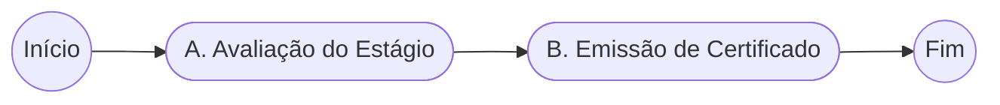
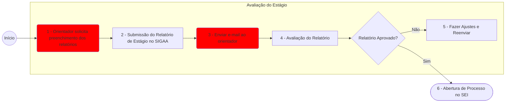

## Procedimentos para Estágios Gerenciados pelo SIGAA

Para concluir seu estágio pelo **SIGAA**, é necessario passar por duas etapa distintas, ilustradas no fluxoo grama abaixo:

Na etapa de [Avaliação do Estágio](#avaliação-do-estágio), o(a) orientador(a) solicita ao(à) discente o preenchimento dos relatórios de estágio no SIGAA, que serão avaliados pelo(a) próprio(a) orientador(a). Após essa etapa, é necessário utilizar o **SEI** para solicitar [Emissão do Certificado](#emissão-de-certificado) do estágio. As seções abaixo detalham o passo a passo de cada etapa.

> ⚠️ **Leiam com atenção, para evitar contratempos.**

### Avaliação do Estágio

Nesta etapa, o(a) orientador(a) deve solicitar ao(à) discente o preenchimento dos relatórios de estágio, explicando que estes serão submetidos no **SIGAA**. Após o preenchimento, lembre-se que o(a) discente deve **`notificar o(a) orientador(a) por e-mail (Passo 3)`** informando que **todos os elementos** foram preenchidos e já podem ser avaliados. A figura abaixo ilustra todos os passos dessa etapa.

Nesta etapa, o(a) orientador(a) solicita ao(à) discente o preenchimento dos relatórios de estágio (`passo 1`), que devem ser submetidos no SIGAA (`passo 2`). O(a) discente deve **notificar o(a) orientador(a) por e-mail**, pois o SIGAA não notifica automaticamente o(a) orientador(a), assim que todos os elementos do processo estiverem devidamente preenchidos, pois somente após essa notificação a [avaliação do estágio](#avaliação-do-estágio) será iniciada (`passo 4`). A figura abaixo ilustra o fluxo de atividades que compõem esta etapa.

> **É importante lembrar que o seu trabalho só será avaliado se você notificar o(a) orientador(a)**, pois o SIGAA não possui a função de envio automático de notificações.

TL;DR:
> 1. **Submissão do Relatório**  
>   O estudante deve submeter o relatório de estágio para avaliação.
>
> 2. **Avaliação do Relatório**  
>   O responsável pela supervisão realiza a análise do relatório.
>
>3. **Aprovação**  
> Se aprovado, o estudante deve iniciar o processo no SEI.

#### A avaliação

No SIGAA, há um formulário disponível que reúne diferentes partes do processo de avaliação, sumárizados abaixo:

1. **Perguntas sobre o estágio** – Você descreverá aspectos importantes sobre suas atividades, responsabilidades e aprendizado.
2. **Autoavaliação** – Você atribuirá notas a diferentes competências, como pontualidade, iniciativa e relacionamento com a equipe.
3. 📌 **Relatório de Estágio** – Documento que deve ser revisado e assinado digitalmente pelo seu orientador acadêmico antes de ser anexado.
    - Lembrando que não ha modelo para o relátorio de estágio
    - 🔏📝 Este documento deve ser assinado, para mais informações de como assinar veja o [link](../assinaturas.md)
4. 📌 **Avaliação do Supervisor** – Formulário que deve ser preenchido e assinado pelo seu supervisor técnico e anexado ao processo.
    - [📄 Formulário de Avaliação do Supervisor](../formularios/avaliacao_supervisor.pdf)
    - 🔏📝 Este documento deve ser assinado, para mais informações de como assinar veja o [link](../assinaturas.md)

> **⚠️ Antes de iniciar o preenchimento do formulário no SIGAA**, certificar-se de que todos os documentos obrigatórios já estão prontos. Isso inclui o termo de compromisso, o relatório revisado e assinado, autoavaliação e a avaliação do supervisor. Dessa forma, o processo de submissão ocorrerá de forma mais ágil;

### Emissão de Certificado

Após o(a) orientador(a) concluir a [avaliação do estágio](#avaliação-do-estágio), o(a) discente deve abrir um processo no SEI do tipo **“Graduação: Programas de Estágio Não Obrigatório”**, endereçado à **CE/UASC**, para que as horas de estágio sejam devidamente registradas no histórico acadêmico.

Uma vez aberto o processo e anexados os documentos, o(a) estudante **deve notificar a coordenação de estágio por e-mail sobre a abertura do processo**, para que a tramitação siga corretamente. Após a notificação, a coordenação de estágio emite a declaração correspondente.

> ⚠️ Para que o estudante ter as horas do estágio não obrigatório devidamente computadas em seu histórico acadêmico o aluno deve abrir um outro processo junto a coordenação do curso
